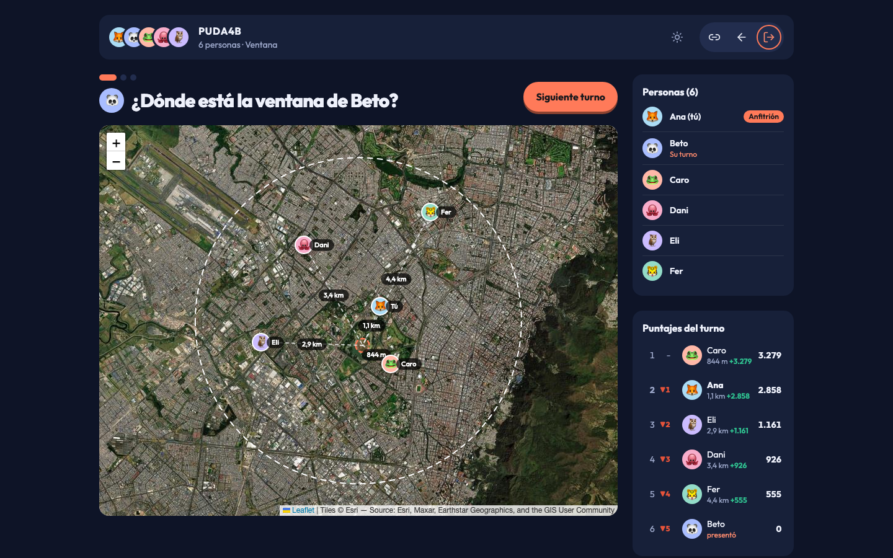
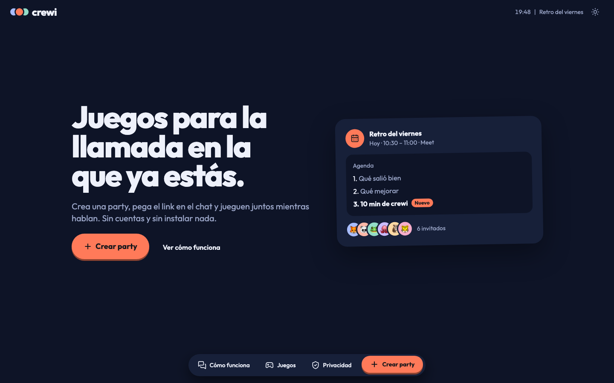
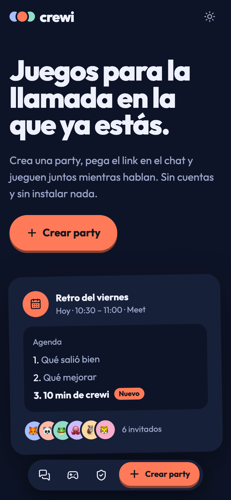
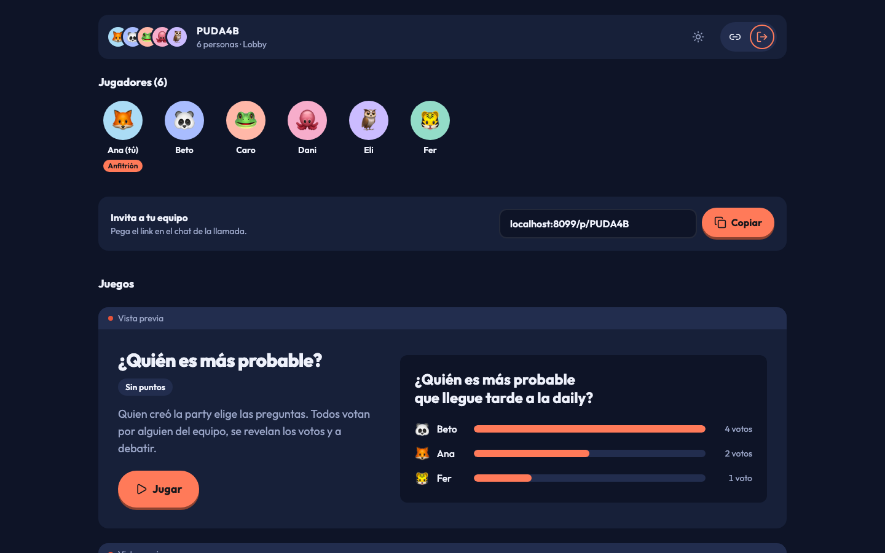
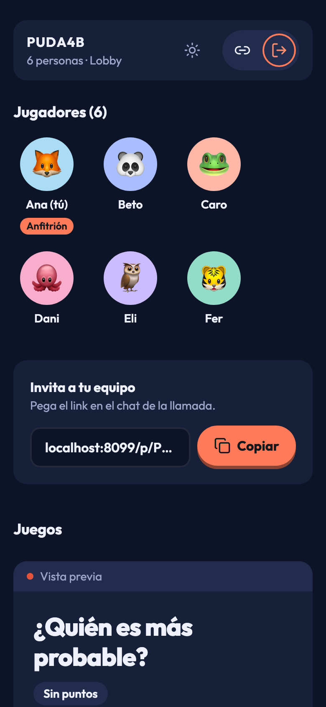
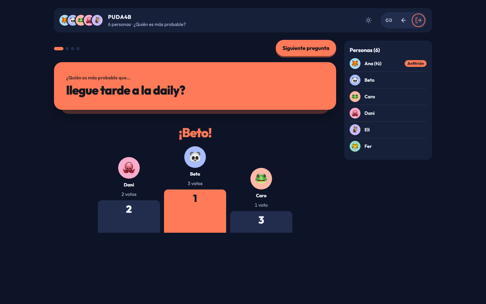
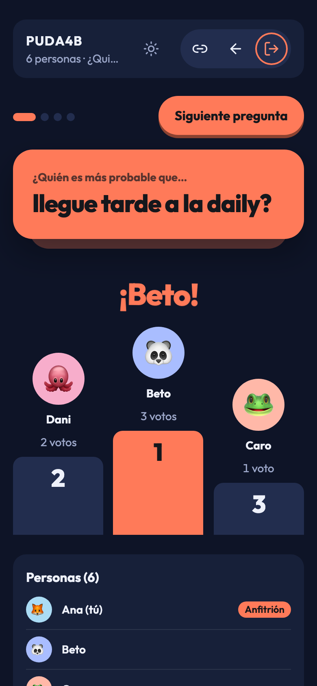
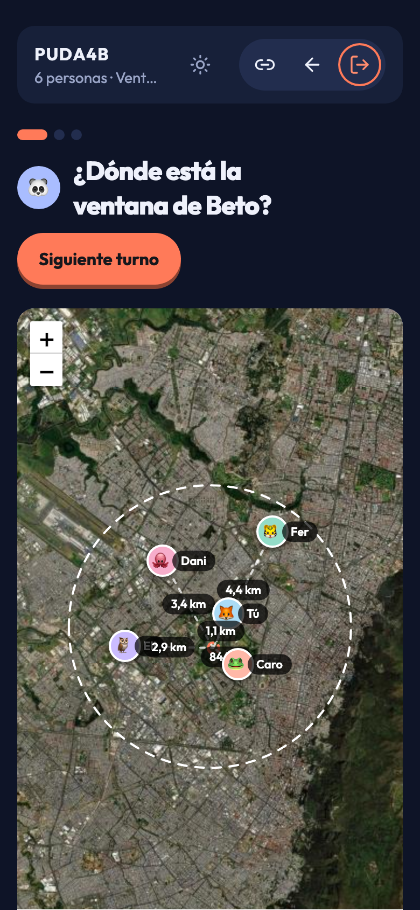

<div align="center">


# crewi

**Browser games for the video call your team is already on.**

 Go &nbsp;·&nbsp;  React &nbsp;·&nbsp;  TypeScript &nbsp;·&nbsp;  Tailwind CSS &nbsp;·&nbsp;  Leaflet &nbsp;·&nbsp;  Docker

[Features](#features) · [Docs](docs/ARCHITECTURE.md) · [License](LICENSE)

</div>

**The problem:** a remote team wants ten minutes of something fun at the end of a meeting, and every option asks for accounts, installs or a paid plan before anyone has played. By the time everyone is in, the ten minutes are gone.

**What crewi does:** one person creates a party and pastes the link in the call chat. Everyone opens it, types a name, picks an emoji or a camera photo, and plays in the browser while they keep talking on the call. Nothing is stored: parties live in server memory and disappear on their own.

**Who it's for:** teams that already meet on Meet, Zoom or Teams. Not a video call replacement; crewi has no audio or video. The interface is in Spanish.

<!-- demo-video:start -->
<!-- Pending: run /brag-slim, drag brag-output/brag.mp4 (<10 MB) into a GitHub issue comment,
     paste the user-attachments URL on its own line here, then remove this comment. -->
<!-- demo-video:end -->



> [!WARNING]
> There are no accounts: the party link is the only key, and anyone who has it can join and see every player's name and photo. Serve it over HTTPS and share links only in your own call. Details in [Security](#security).

[Features](#features) · [How do I…](#how-do-i) · [Running](#running) · [Configuration](#configuration) · [Documentation](#documentation) · [Security](#security)

## Features

**Home**

- Create a party in one click, no sign-up
- Rejoin or leave a party you were already in
- Light and dark theme that follows the system

<table><tr>
<td width="74%"></td>
<td></td>
</tr></table>

**Lobby**

- See who is online, up to 20 players per party
- Copy the invite link for the call chat
- The host previews each game and starts one

<table><tr>
<td width="74%"></td>
<td></td>
</tr></table>

**¿Quién es más probable?**

- The host builds the round one question card at a time
- Everyone votes for a teammate; a side panel shows who already answered
- Votes land on a podium to argue about, no points

<table><tr>
<td width="74%"></td>
<td></td>
</tr></table>

**Ventana**

- Each player shows their real window on the call, with hints of what to describe
- The others guess the spot on a satellite map; closer means more points
- Share an exact point or only an approximate circle

<table><tr>
<td width="74%"></td>
<td></td>
</tr></table>

## How do I…

### Start a party
Home → Crear party. Type your name, pick an emoji or take a camera photo, then copy the link from the lobby into the call chat. Whoever creates the party is the host.

### Play a game and move to the next one
The host presses Jugar on a game in the lobby. When it ends, or when the host presses the back arrow in the header, everyone returns to the lobby with the party intact and the host picks another.

### Play Ventana without giving away my address
In the setup, choose Usar mi ubicación or Marcarla en el mapa, then pick a zone of 100, 200 or 500 m instead of the exact point. The circle is shifted at random and the server never keeps the exact location.

### Get back in after closing the tab
Open the party link again, or the home page, which shows a banner for the party you were in. The browser keeps your seat, so you come back as the same player without joining again.

### Add questions to ¿Quién es más probable?
Add lines to `internal/game/mostlikely/questions.txt`. Each line completes "¿Quién es más probable que…". The file is embedded at build time, so rebuild after editing it.

## Running

| I want to… | Run |
|---|---|
| Try it | `docker run -p 8080:8080 ghcr.io/juanhdzma/crewi:latest` |
| Work on the frontend | `cd web && npm install && npm run dev` (backend on :8080), then open http://localhost:5173 |
| Work on the backend | `go run ./cmd/crewi` (needs `web/dist`: `cd web && npm run build`) |
| Deploy | The compose file behind an HTTPS proxy, in [docs/DEPLOYMENT.md](docs/DEPLOYMENT.md) |

## Configuration

One environment variable, with a default.

```bash
PORT=8080   # HTTP port the server listens on.
```

## Documentation

| Doc | Read it when |
|---|---|
| [Architecture](docs/ARCHITECTURE.md) | You want to know how it works and why it's built this way |
| [Deployment](docs/DEPLOYMENT.md) | You're running it on a server or upgrading |
| [Development](docs/DEVELOPMENT.md) | You're changing code: setup, tests, adding a game |
| [Product](docs/PRODUCT.md) | You need the users, positioning and product principles |
| [Design](docs/DESIGN.md) | You're touching the UI: tokens, type, components, voice |

## Security

crewi is built for a team that trusts each other, sharing a link inside its own call.

- **The link is the only key.** There are no accounts or passwords. Anyone with the six-character party code can join, and can read the names and photos of the players in it.
- **Nothing is persisted.** Parties, scores, photos and locations live in the memory of one process. A photo is dropped when its player leaves, a party is deleted after 30 minutes empty, and a restart wipes everything.
- **Locations stay hidden until your turn.** With a zone instead of an exact point, the server keeps only a randomly shifted circle and discards the point.
- **HTTPS is required.** Browsers only grant geolocation and the camera in a secure context, so Ventana and join photos do not work over plain HTTP outside localhost.
- **Map tiles come from Esri.** Each browser requests satellite tiles from Esri World Imagery directly. Esri's terms require an ArcGIS license for that endpoint; get a free ArcGIS Location Platform key before any public or commercial use.

---

AGPL-3.0 · [LICENSE](LICENSE)
